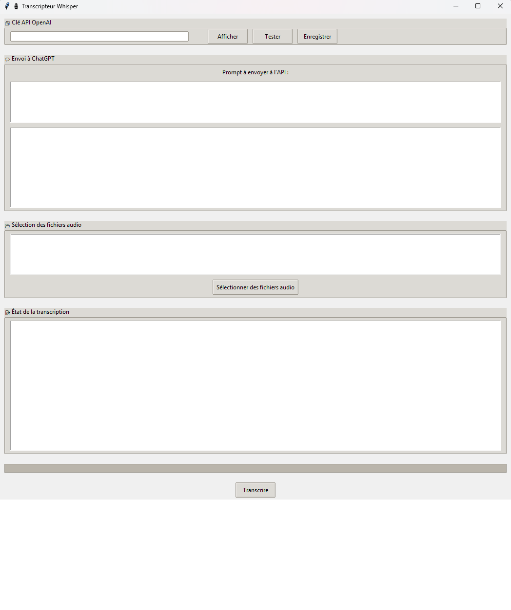

# Transcripteur Whisper 🎙️

Application de transcription audio avec Whisper et interface graphique Tkinter.  
Elle permet également d'envoyer le texte transcrit à l'API OpenAI (ChatGPT) pour enrichissement ou résumé.

## Fonctionnalités
- Transcription de fichiers audio (.wav, .mp3, .m4a, .flac)
- Exécution Whisper locale ; le choix CPU/GPU dépend du moteur et de PyTorch
- Interface Tkinter simple et claire
- Envoi à l'API OpenAI (GPT-3.5-turbo)
- Enregistrement automatique des préférences utilisateur

## Ecran


## Prérequis

- Python 3.11 ou supérieur (environnement de référence : 3.11)
- Une clé API OpenAI : https://platform.openai.com/account/api-keys

## Installation

Créer et activer un environnement virtuel avant l’installation. FFmpeg doit être installé et accessible dans le PATH pour le décodage audio.

```bash
python -m pip install -r requirements.txt
```

## Utilisation

```bash
python main.py
```

## Configuration

Crée un fichier `.env` à la racine avec :

```env
OPENAI_API_KEY=votre_cle_locale
```

---

## Fichiers

- `main.py` : point d'entrée de l'application
- `gui.py` : interface utilisateur
- `openai_chat.py` : interaction avec l'API OpenAI
- `whisper_engine.py` : transcription audio via Whisper
- `config.py` : sauvegarde des préférences
- `utils.py` : fonctions utilitaires

## Licence

MIT


## Qualité et limites

```bash
python -m unittest discover -s tests -v
```

Les tests de préférences et de transcription isolent le moteur audio : aucun GPU, modèle téléchargé ou appel API payant n’est nécessaire. La transcription réelle et l’interface doivent être vérifiées séparément.

Le moteur utilise actuellement le modèle Whisper `base`. Les préférences modèle/langue/CUDA/découpage présentes dans le code d’interface ne sont pas toutes raccordées au moteur ; leur sauvegarde ne signifie pas qu’elles modifient la transcription. L’appel API est présent dans `openai_chat.py`, mais son parcours utilisateur reste à finaliser dans l’interface.

La clé peut être enregistrée dans `.env`, exclu de Git. Les nouvelles sauvegardes des préférences ne l’incluent plus ; un ancien fichier de préférences peut encore la contenir. Le traitement local de l’audio et l’envoi de texte à une API sont deux flux distincts.

`requirements.in` définit les contraintes ; `requirements.txt` fige la résolution des dépendances. Pour la mettre à jour volontairement avec uv :

```bash
uv pip compile requirements.in --universal --python-version 3.11 --output-file requirements.txt
```

La résolution des dépendances ne remplace pas un essai d’installation audio/GPU sur la machine cible.
